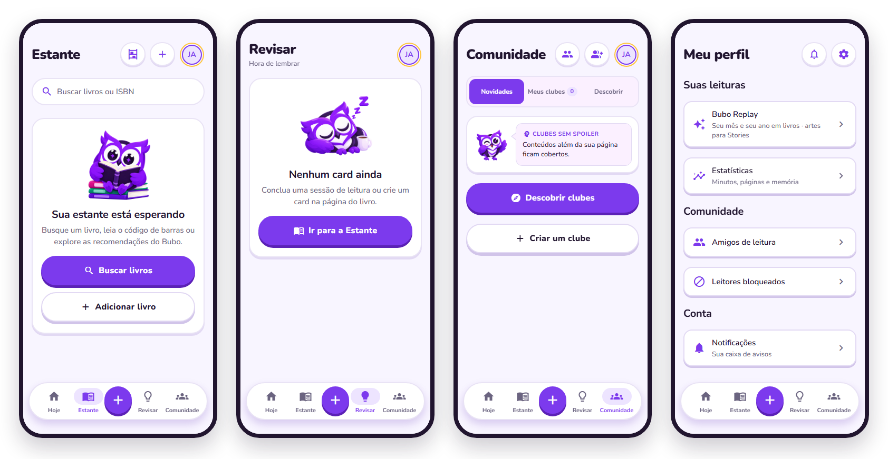

<div align="center">

<picture>
  <source media="(prefers-color-scheme: dark)" srcset="docs/assets/readme/logo-escuro.png" />
  
</picture>

### Leia com presença. Lembre com confiança.

Um companheiro de leitura que transforma páginas lidas em ideias que ficam.

<br />

<a href="https://github.com/joao-araujoo/bubo/releases/latest/download/bubo.apk"></a>

<sub>Android 7.0 ou mais novo · em português · em desenvolvimento · <a href="https://github.com/joao-araujoo/bubo/releases/latest">notas da versão</a></sub>

</div>

<br />

<picture>
  <source media="(prefers-color-scheme: dark)" srcset="docs/assets/readme/telas-escuro.png" />
  
</picture>

<p align="center"><sub>Estante, Revisar, Comunidade e Meu perfil com uma conta recém-criada: tudo começa vazio e se enche com a sua leitura.</sub></p>

---

## O que é o Bubo?

O Bubo ajuda você a **ler com foco, lembrar sem espiar e revisar na hora certa**. Cada sessão de leitura vira uma pequena prática de memória: você registra onde parou, conta com as suas palavras o que ficou e volta às ideias antes que elas se percam. Sozinho ou em clubes, sem spoilers.

<div align="center">
  
  
  
</div>

### A jornada de leitura

1. **Escolha um livro.** Busque por título, autor ou ISBN, leia o código de barras ou cadastre à mão.
2. **Leia com foco.** O marcador noturno acompanha os minutos e a página em que você parou.
3. **Lembre sem consultar.** Antes de salvar, escreva a ideia, um detalhe e uma conexão do que leu.
4. **Revise no momento certo.** Os cards voltam em repetição espaçada, quando a memória mais precisa.

## O que tem no app

| Área           | O que você encontra                                                                                           |
| -------------- | ------------------------------------------------------------------------------------------------------------- |
| **Hoje**       | O livro atual em destaque com as cores da capa, um botão para continuar, meta do dia, sequência e revisões.   |
| **Estante**    | Lendo, Quero ler, Lidos, Favoritos e Tenho; busca e leitor de código de barras; página do livro em 3D.        |
| **Revisar**    | Os cards do dia, a cartela de carimbos, o desafio do mês e treinos rápidos com o que escapou.                 |
| **Comunidade** | Clubes de leitura com debates protegidos contra spoiler, enquetes, resenhas, convites, amigos e liga semanal. |
| **Você**       | Perfil, conquistas, estatísticas, o Bubo Replay do mês e do ano, widgets e preferências.                      |

O botão **+** no centro da barra reúne os atalhos: continuar a leitura, ler 5 minutos, adicionar um livro, escanear um código e revisar.

## Instalar no Android

1. No celular, toque em **Baixar para Android** acima (ou abra a [última versão](https://github.com/joao-araujoo/bubo/releases/latest)).
2. Abra o arquivo `bubo.apk`. Se o Android pedir, permita instalar apps dessa fonte.
3. Abra o Bubo e crie sua conta.

> [!NOTE]
> É uma versão de teste, instalada fora da Play Store, por isso o Android avisa que o app vem de uma fonte desconhecida. Para atualizar, baixe a versão nova e instale por cima: sua estante e suas revisões ficam na sua conta. Ainda não há versão para iPhone.

## Como o progresso é calculado

O Bubo recompensa a prática, principalmente o esforço de lembrar. Todo número vem de atividade registrada: uma estante nova começa em zero.

| Atividade               | XP                                                     |
| ----------------------- | ------------------------------------------------------ |
| Leitura focada          | **1 XP por minuto inteiro**, até 60 minutos por sessão |
| Tentativa de recordação | **2 XP por tentativa**                                 |
| Resposta lembrada       | **+3 XP por acerto**                                   |
| Revisão concluída       | **+25 XP** quando houve pelo menos uma tentativa       |

Uma sessão de **20 minutos** rende **20 XP**. Uma revisão concluída com **3 tentativas e 2 acertos** rende **37 XP**: `3 × 2 + 2 × 3 + 25`. A sessão só conta depois do exercício de recordação.

A **sequência** soma dias seguidos com leitura ou revisão, no calendário local de quem lê. A cada 7 dias ativos você ganha uma **proteção** (até 2) que segura a sequência num dia sem atividade. As revisões seguem repetição espaçada: o que foi difícil volta no dia seguinte e os intervalos crescem conforme você lembra.

## Feito com cuidado

- **Sem dados inventados.** Telas vazias explicam o próximo passo em vez de mostrar números de mentira.
- **Suas reflexões são suas.** Amigos só veem o que você escolher compartilhar; nos clubes, o que passa da página em que você está fica coberto até você decidir revelar.
- **IA opcional.** O Gemini, chamado só pelo servidor e com seu consentimento, apenas sugere uma pergunta; o app funciona igual sem ele.

<details>
<summary><strong>Tecnologia e desenvolvimento</strong></summary>

<br />

| Parte   | Tecnologia                                                           |
| ------- | -------------------------------------------------------------------- |
| App     | Expo SDK 57, React Native, Expo Router, TanStack Query, fonte Nunito |
| API     | Hono no Cloudflare Workers, Better Auth, cron de lembretes           |
| Dados   | Neon Postgres com Drizzle; regras puras e testadas em `packages/*`   |
| Widgets | Android App Widgets e iOS WidgetKit, a partir dos tokens do app      |

```sh
npm install          # na raiz (só npm)
npm run dev:api      # API local
npm run dev:mobile   # app no Expo
npm run verify       # formato, lint, tipos, testes, assets e auditoria
```

Comece pela [documentação](docs/README.md); as decisões estão nos ADRs em [`docs/adr`](docs/adr). Regras do repositório em [AGENTS.md](AGENTS.md).

</details>

<details>
<summary><strong>Para o dono do projeto</strong></summary>

<br />

- **[CONFIGURAR.md](CONFIGURAR.md)**: o que ainda depende de você (contas, chaves, lojas).
- **[docs/TESTAR-TELAS.md](docs/TESTAR-TELAS.md)**: roteiro para testar cada tela no celular.
- **[docs/release.md](docs/release.md)**: estado da API, do banco e do último APK.

</details>

---

<div align="center">
  

**Leia profundamente. Guarde o que importa.**

</div>
